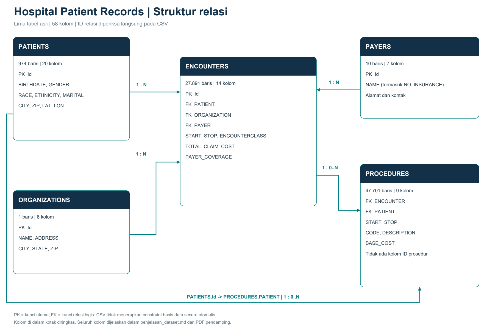
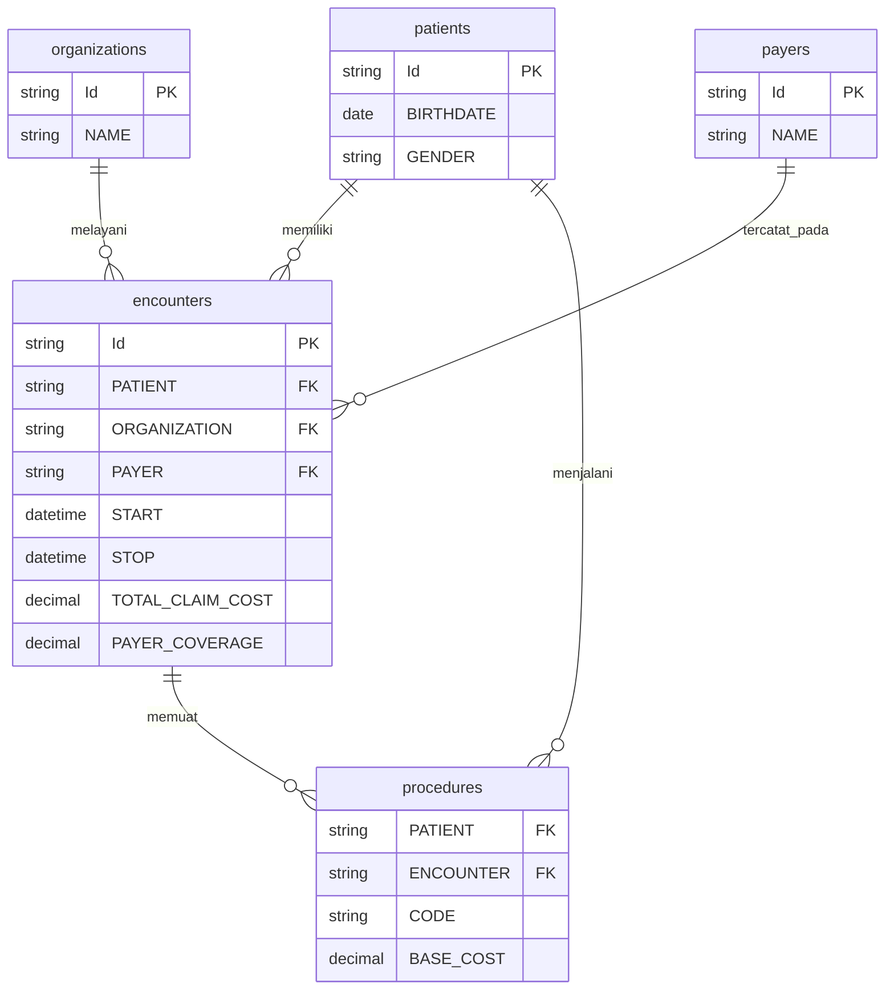
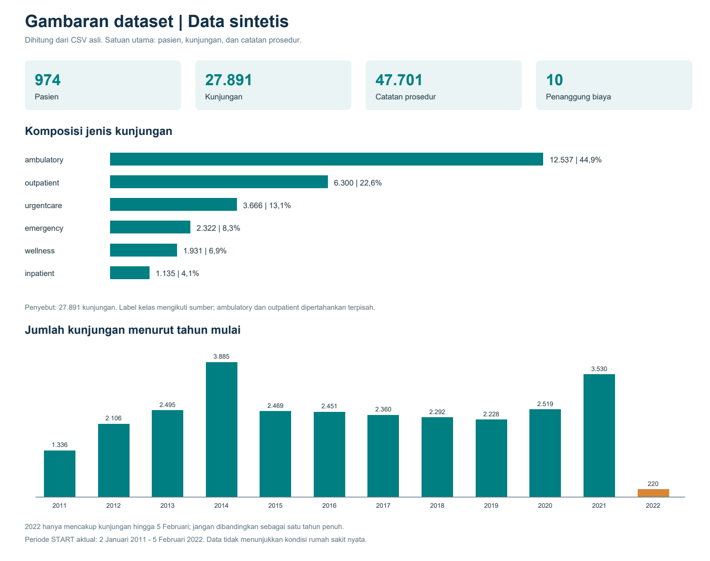

# Penjelasan Dataset Hospital Patient Records

Dataset ini merupakan data pasien sintetis berbasis Synthea yang disediakan untuk Maven Hospital Challenge. Data bukan rekam medis pasien nyata dan tidak dapat dipakai untuk menyimpulkan kinerja aktual Massachusetts General Hospital. Berkas diunduh dari tautan arsip publik resmi Maven pada 22 Oktober 2026.

## 1. Sumber dan berkas

- Halaman challenge: https://mavenanalytics.io/challenges/maven-hospital-challenge
- Halaman dataset: https://mavenanalytics.io/data-playground/hospital-patient-records
- Arsip unduhan resmi: https://maven-datasets.s3.amazonaws.com/Hospital+Patient+Records/Hospital+Patient+Records.zip
- Lisensi pada halaman Maven: Public Domain. Atribusi sumber tetap disarankan.
- CSV asli dipertahankan dalam `data_asli/`; skrip SQL sumber disimpan terpisah dan tidak dijalankan.
- Rujukan Synthea dari `citation.txt`: https://doi.org/10.1093/jamia/ocx079.

## 2. Inventaris dan unit analisis

| Tabel | Satu baris mewakili | Baris | Kolom | Kunci utama |
| --- | --- | ---: | ---: | --- |
| `patients.csv` | Satu pasien sintetis | 974 | 20 | `Id` |
| `encounters.csv` | Satu kunjungan / episode layanan | 27.891 | 14 | `Id` |
| `procedures.csv` | Satu catatan tindakan / prosedur | 47.701 | 9 | Tidak ada ID eksplisit |
| `payers.csv` | Satu penanggung biaya, termasuk NO_INSURANCE | 10 | 7 | `Id` |
| `organizations.csv` | Satu organisasi penyedia layanan | 1 | 8 | `Id` |

Total: **76.577 baris lintas lima tabel dan 58 kolom**. Penjumlahan baris lintas tabel bukan jumlah pasien atau kejadian unik. `data_dictionary.csv` merupakan dokumentasi pendamping, bukan tabel analisis keenam.

**Perbedaan dokumentasi:** kamus bawaan menyebut `Middle` dan `FIPS County Code` pada patients, tetapi keduanya tidak ada di CSV aktual. Nama kolom dokumentasi juga memakai kapitalisasi berbeda. Penjelasan ini mengikuti nama dan jumlah kolom CSV yang diunduh, bukan angka ringkasan pada situs.

## 3. Relasi antartabel

| Relasi | Makna | ID anak tanpa induk |
| --- | --- | ---: |
| `encounters.PATIENT` → `patients.Id` | Banyak baris anak dapat merujuk satu induk | 0 |
| `encounters.PAYER` → `payers.Id` | Banyak baris anak dapat merujuk satu induk | 0 |
| `encounters.ORGANIZATION` → `organizations.Id` | Banyak baris anak dapat merujuk satu induk | 0 |
| `procedures.PATIENT` → `patients.Id` | Banyak baris anak dapat merujuk satu induk | 0 |
| `procedures.ENCOUNTER` → `encounters.Id` | Banyak baris anak dapat merujuk satu induk | 0 |

Empat tabel memiliki `Id` unik dan tidak kosong: patients, encounters, payers, organizations. Procedures tidak memiliki ID eksplisit; jangan menganggap `CODE` atau pasangan PATIENT-ENCOUNTER sebagai kunci unik. Diagram menunjukkan relasi logis dari CSV, bukan constraint yang sedang dijalankan pada basis data.

Pada salinan ini, seluruh 974 pasien memiliki kunjungan. Sebanyak **793 pasien** dan **14.670 kunjungan** mempunyai catatan prosedur. Terdapat **181 pasien** dan **13.221 kunjungan** tanpa baris prosedur; pertahankan mereka dengan left join jika analisis membutuhkan seluruh populasi. Seluruh pasangan PATIENT pada prosedur konsisten dengan PATIENT kunjungannya.

## 4. Kamus seluruh kolom aktual

Tipe di bawah merupakan tipe analitis yang disarankan. CSV sendiri menyimpan teks. ID, kode SNOMED-CT, nomor telepon, dan ZIP sebaiknya dipertahankan sebagai teks.

### patients.csv

Satu pasien sintetis.

| Kolom asli | Tipe analitis | Penjelasan | Sel kosong |
| --- | --- | --- | ---: |
| `Id` | Teks / kategori | ID unik tabel; kunci utama. | 0 |
| `BIRTHDATE` | Tanggal | Tanggal lahir pasien (YYYY-MM-DD). | 0 |
| `DEATHDATE` | Tanggal | Tanggal kematian bila tercatat; kosong bukan nilai nol. | 820 |
| `PREFIX` | Teks / kategori | Sapaan / gelar sebelum nama. | 0 |
| `FIRST` | Teks / kategori | Nama depan sintetis. | 0 |
| `LAST` | Teks / kategori | Nama keluarga sintetis. | 0 |
| `SUFFIX` | Teks / kategori | Gelar / penanda setelah nama; opsional. | 953 |
| `MAIDEN` | Teks / kategori | Nama sebelum menikah; opsional. | 588 |
| `MARITAL` | Teks / kategori | Status pernikahan; M = menikah, S = lajang. | 1 |
| `RACE` | Teks / kategori | Kategori ras yang tercatat. | 0 |
| `ETHNICITY` | Teks / kategori | Kategori etnis yang tercatat. | 0 |
| `GENDER` | Teks / kategori | Kode gender pada sumber; F = perempuan, M = laki-laki. | 0 |
| `BIRTHPLACE` | Teks / kategori | Tempat lahir sintetis. | 0 |
| `ADDRESS` | Teks / kategori | Alamat yang tercatat. | 0 |
| `CITY` | Teks / kategori | Kota pada alamat. | 0 |
| `STATE` | Teks / kategori | Negara bagian pada alamat. | 0 |
| `COUNTY` | Teks / kategori | Wilayah county pada alamat. | 0 |
| `ZIP` | Teks / kategori | Kode pos; simpan sebagai teks agar nol di depan terjaga. | 142 |
| `LAT` | Desimal | Lintang lokasi. | 0 |
| `LON` | Desimal | Bujur lokasi. | 0 |

### encounters.csv

Satu kunjungan / episode layanan.

| Kolom asli | Tipe analitis | Penjelasan | Sel kosong |
| --- | --- | --- | ---: |
| `Id` | Teks / kategori | ID unik tabel; kunci utama. | 0 |
| `START` | Tanggal-waktu | Waktu mulai layanan, format ISO 8601 UTC. | 0 |
| `STOP` | Tanggal-waktu | Waktu selesai layanan, format ISO 8601 UTC. | 0 |
| `PATIENT` | Teks / kategori | ID pasien; merujuk patients.Id. | 0 |
| `ORGANIZATION` | Teks / kategori | ID organisasi; merujuk organizations.Id. | 0 |
| `PAYER` | Teks / kategori | ID penanggung biaya; merujuk payers.Id. | 0 |
| `ENCOUNTERCLASS` | Teks / kategori | Kategori layanan yang tercatat; enam kategori aktual. | 0 |
| `CODE` | Teks / kategori | Kode layanan atau tindakan SNOMED-CT. Simpan sebagai teks. | 0 |
| `DESCRIPTION` | Teks / kategori | Deskripsi kode layanan atau tindakan. | 0 |
| `BASE_ENCOUNTER_COST` | Desimal | Biaya dasar kunjungan, tidak termasuk rincian layanan tambahan (USD). | 0 |
| `TOTAL_CLAIM_COST` | Desimal | Total biaya kunjungan beserta rincian layanannya (USD). | 0 |
| `PAYER_COVERAGE` | Desimal | Nilai biaya yang tercatat ditanggung penjamin (USD). | 0 |
| `REASONCODE` | Teks / kategori | Kode alasan / kondisi SNOMED-CT; dapat kosong. | 19.541 |
| `REASONDESCRIPTION` | Teks / kategori | Deskripsi alasan / kondisi; dapat kosong. | 19.541 |

### procedures.csv

Satu catatan tindakan / prosedur.

| Kolom asli | Tipe analitis | Penjelasan | Sel kosong |
| --- | --- | --- | ---: |
| `START` | Tanggal-waktu | Waktu mulai layanan, format ISO 8601 UTC. | 0 |
| `STOP` | Tanggal-waktu | Waktu selesai layanan, format ISO 8601 UTC. | 0 |
| `PATIENT` | Teks / kategori | ID pasien; merujuk patients.Id. | 0 |
| `ENCOUNTER` | Teks / kategori | ID kunjungan; merujuk encounters.Id. | 0 |
| `CODE` | Teks / kategori | Kode layanan atau tindakan SNOMED-CT. Simpan sebagai teks. | 0 |
| `DESCRIPTION` | Teks / kategori | Deskripsi kode layanan atau tindakan. | 0 |
| `BASE_COST` | Desimal | Biaya item prosedur (USD). | 0 |
| `REASONCODE` | Teks / kategori | Kode alasan / kondisi SNOMED-CT; dapat kosong. | 36.945 |
| `REASONDESCRIPTION` | Teks / kategori | Deskripsi alasan / kondisi; dapat kosong. | 36.945 |

### payers.csv

Satu penanggung biaya, termasuk NO_INSURANCE.

| Kolom asli | Tipe analitis | Penjelasan | Sel kosong |
| --- | --- | --- | ---: |
| `Id` | Teks / kategori | ID unik tabel; kunci utama. | 0 |
| `NAME` | Teks / kategori | Nama organisasi atau penanggung biaya. | 0 |
| `ADDRESS` | Teks / kategori | Alamat yang tercatat. | 1 |
| `CITY` | Teks / kategori | Kota pada alamat. | 1 |
| `STATE_HEADQUARTERED` | Teks / kategori | Negara bagian alamat kantor penanggung biaya. | 1 |
| `ZIP` | Teks / kategori | Kode pos; simpan sebagai teks agar nol di depan terjaga. | 1 |
| `PHONE` | Teks / kategori | Nomor telepon; simpan sebagai teks. | 1 |

### organizations.csv

Satu organisasi penyedia layanan.

| Kolom asli | Tipe analitis | Penjelasan | Sel kosong |
| --- | --- | --- | ---: |
| `Id` | Teks / kategori | ID unik tabel; kunci utama. | 0 |
| `NAME` | Teks / kategori | Nama organisasi atau penanggung biaya. | 0 |
| `ADDRESS` | Teks / kategori | Alamat yang tercatat. | 0 |
| `CITY` | Teks / kategori | Kota pada alamat. | 0 |
| `STATE` | Teks / kategori | Negara bagian pada alamat. | 0 |
| `ZIP` | Teks / kategori | Kode pos; simpan sebagai teks agar nol di depan terjaga. | 0 |
| `LAT` | Desimal | Lintang lokasi. | 0 |
| `LON` | Desimal | Bujur lokasi. | 0 |

## 5. Hasil pemeriksaan kualitas

- Tidak ditemukan baris identik pada masing-masing dari lima tabel.
- Tidak ditemukan ID kosong atau ID berulang pada empat tabel yang memiliki Id.
- Tidak ditemukan ID relasi yang tidak memiliki induk pada lima hubungan yang diperiksa.
- Tidak ditemukan STOP lebih awal dari START pada encounters dan procedures.
- Tidak ditemukan perbedaan ID pasien antara baris prosedur dan kunjungan yang dirujuknya.
- Terdapat nilai kosong pada beberapa kolom; jumlah per kolom ada pada kamus di atas dan hasil_pemeriksaan.json. Pemeriksaan ini belum merupakan audit klinis lengkap atau jaminan bahwa setiap catatan valid.

**Makna kosong yang penting:** kolom alasan kunjungan kosong pada 19.541 dari 27.891 kunjungan; kolom alasan prosedur kosong pada 36.945 dari 47.701 prosedur. Nilai tersebut tidak boleh diartikan sebagai tidak ada penyakit. Atribut kontak payer yang kosong berada pada kategori NO_INSURANCE; kategori ini adalah label eksplisit, bukan nilai kosong PAYER.

## 6. Aturan penggabungan dan interpretasi

### Pilih unit analisis sebelum menggabungkan tabel.

Gunakan patients untuk menghitung orang, encounters untuk kunjungan, dan procedures untuk catatan tindakan. Jumlah baris hasil join bukan otomatis jumlah pasien.

### Hindari penggandaan biaya.

Satu kunjungan dapat memiliki banyak prosedur. Menjumlahkan TOTAL_CLAIM_COST setelah join langsung ke procedures akan menggandakan biaya kunjungan. Ringkas prosedur per ENCOUNTER sebelum join atau hitung biaya di tabel encounters.

### Hubungkan prosedur melalui ENCOUNTER.

Untuk mengaitkan tindakan dengan kunjungan, gunakan procedures.ENCOUNTER = encounters.Id. Join hanya melalui PATIENT akan memasangkan tindakan dengan kunjungan lain milik pasien yang sama.

### Jangan menjumlahkan komponen biaya yang bertumpang tindih.

TOTAL_CLAIM_COST sudah mencakup item layanan. BASE_ENCOUNTER_COST dan BASE_COST prosedur memiliki cakupan berbeda; jangan menambahkan semuanya sebagai total baru.

### Bedakan cakupan penjamin dari pengeluaran pasien.

PAYER_COVERAGE adalah nilai cakupan yang tercatat. Selisih TOTAL_CLAIM_COST - PAYER_COVERAGE boleh disebut biaya yang tidak tercakup pada catatan ini, bukan otomatis pembayaran tunai pasien atau utang yang sudah tertagih.

### Kunjungan berulang bukan otomatis readmisi klinis.

Tetapkan definisi episode, jenis rawat inap, urutan keluar-masuk, serta jendela waktu bila ingin menghitung readmisi. Jangan menyebut semua pasien dengan beberapa kunjungan sebagai pasien readmisi.

### Gunakan tanggal yang relevan.

Usia sebaiknya dihitung pada START kunjungan, bukan menggunakan usia saat ini. Durasi = STOP - START; hitung untuk kelas layanan yang sesuai. Data 2022 berhenti pada 5 Februari.

### Pertahankan nilai kosong sesuai maknanya.

DEATHDATE kosong berarti tanggal kematian tidak tercatat. SUFFIX dan MAIDEN bersifat opsional; REASONCODE tidak selalu tersedia. Jangan mengganti semua nilai kosong dengan nol atau menghapus semua baris yang tidak lengkap.

## 7. Visualisasi awal

Visual dihitung dari tabel encounters tanpa menggandakan baris melalui join. Komposisi menggunakan penyebut 27.891 kunjungan; tren memakai tahun START. Kategori ambulatory dan outpatient dipertahankan sebagai dua label sumber yang berbeda. Tahun 2022 hanya periode parsial.

## 8. Arah eksplorasi infografis

Pertanyaan berikut merupakan rekomendasi analisis, bukan hubungan sebab-akibat yang telah dibuktikan.

| Fokus | Ukuran | Visual |
| --- | --- | --- |
| Profil pemanfaatan layanan | Distribusi jenis kunjungan menurut usia saat kunjungan atau gender; penyebut harus jelas. | Batang berkelompok / 100% |
| Konsentrasi kunjungan | Jumlah kunjungan per pasien; median, kuartil, dan porsi kunjungan dari kelompok frekuensi tinggi. | Histogram / kurva kumulatif |
| Cakupan pembiayaan | SUM(PAYER_COVERAGE) / SUM(TOTAL_CLAIM_COST) menurut kelas layanan atau penjamin. | Batang persentase |
| Perubahan aktivitas layanan | Jumlah kunjungan per tahun atau bulan mulai; bandingkan periode yang setara. | Garis / batang |
| Durasi dan biaya layanan | Median durasi serta biaya menurut ENCOUNTERCLASS; pisahkan rawat inap. | Boxplot / batang median |

## 9. Ringkasan angka dasar

- Periode START kunjungan: `2011-01-02T09:26:36Z` hingga `2022-02-05T20:27:36Z`.
- Total TOTAL_CLAIM_COST: USD 101,514,375.52.
- Total PAYER_COVERAGE: USD 31,097,506.99.
- Rasio cakupan tertimbang: 30.63%. Ini rasio jumlah biaya, bukan persentase pasien terlindungi atau rata-rata persentase per kunjungan.

## 10. Isi folder

- `data_asli/`: lima CSV analisis, kamus sumber, dan citation.txt.
- `Hospital_Patient_Records_original.zip`: arsip unduhan tanpa perubahan.
- `skrip_sumber/`: dua skrip SQL bawaan, disimpan tanpa dijalankan.
- `visualisasi/erd_hospital.png`: diagram relasi.
- `visualisasi/erd_hospital.mmd`: sumber diagram yang dapat diedit.
- `visualisasi/gambaran_dataset.png`: grafik ringkasan awal.
- `hasil_pemeriksaan.json`: jumlah baris, kosong, validasi relasi, dan hash CSV.
- `penjelasan_struktur_dataset.pdf`: penjelasan dan visual siap dibaca.
