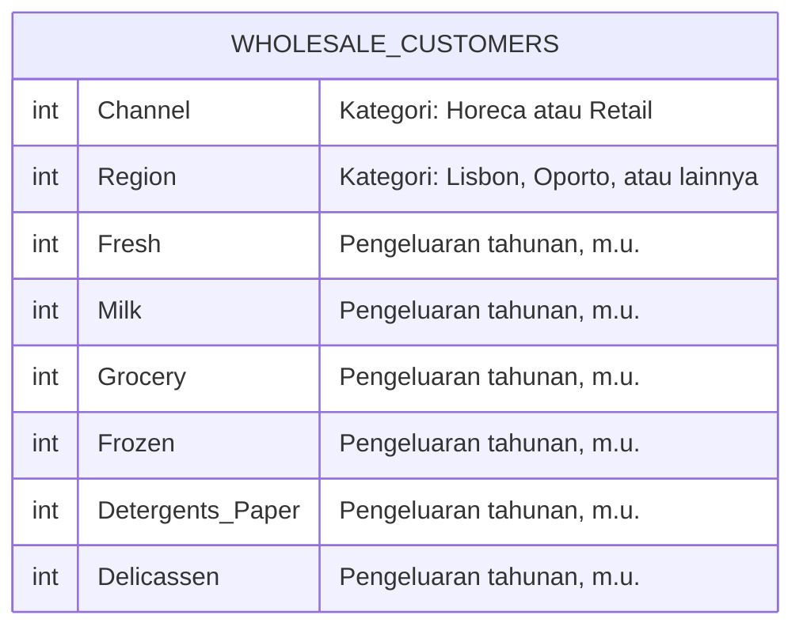

# Penjelasan Dataset Wholesale Customers

## 1. Gambaran dan sumber

Dataset ini memuat profil jenis pelanggan, wilayah, dan pengeluaran tahunan pelanggan sebuah distributor grosir. Satu baris mewakili satu pelanggan; enam kolom pengeluaran merangkum belanja per kategori produk, bukan transaksi individual. Dataset cocok untuk latihan infografis bisnis mengenai perbedaan pola belanja dan komposisi pengeluaran.

- Sumber resmi: [UCI Machine Learning Repository](https://archive.ics.uci.edu/dataset/292/wholesale+customers).
- Pembuat yang dicantumkan UCI: Margarida Cardoso.
- DOI: https://doi.org/10.24432/C5030X.
- Lisensi: CC BY 4.0; cantumkan atribusi saat menggunakan atau mengadaptasi data.
- Tanggal unduh dan pemeriksaan: 22 Oktober 2026.
- Berkas asli: `Wholesale customers data.csv`; arsip unduhan: `wholesale_customers_original.zip`.

Tahun pengamatan belanja dan mata uang spesifik tidak dijelaskan pada halaman sumber yang diperiksa. Tanggal publikasi / donasi bukan tahun pengamatan. Nilai pengeluaran dinyatakan dalam *monetary units* (m.u.); jangan menggantinya dengan rupiah atau euro tanpa sumber tambahan.

## 2. Struktur dan unit analisis

| Aspek | Hasil pemeriksaan berkas |
| --- | --- |
| Tabel | Satu tabel datar |
| Jumlah baris | 440 pelanggan |
| Jumlah kolom | 8 |
| Pemisah CSV | Koma (`,`) |
| Header | Ada pada baris pertama |
| Representasi nilai | Seluruh nilai dapat dibaca sebagai bilangan bulat |
| Variabel kategori | `Channel`, `Region`; angka merupakan kode kategori |
| Variabel pengeluaran | Enam kolom numerik dalam m.u. |
| Primary key / ID pelanggan | Tidak tersedia secara eksplisit |
| Foreign key | Tidak tersedia |
| Relasi antartabel | Tidak ada pada dataset yang diunduh |

**Jumlah delapan kolom mengikuti CSV aktual.** Angka tujuh fitur pada ringkasan UCI mengikuti pembagian peran variabel di repositori, bukan jumlah seluruh kolom berkas.

## 3. Kamus data

| Kolom asli | Jenis analitis | Makna | Minimum-maksimum aktual |
| --- | --- | --- | --- |
| `Channel` | Kategori berkode | Jenis pelanggan: 1 = Horeca (hotel, restoran, kafe); 2 = Retail. | 1-2 |
| `Region` | Kategori berkode | Wilayah pelanggan: 1 = Lisbon; 2 = Oporto; 3 = wilayah lain. | 1-3 |
| `Fresh` | Numerik | Pengeluaran tahunan untuk produk segar, dalam m.u. | 3-112.151 |
| `Milk` | Numerik | Pengeluaran tahunan untuk produk susu, dalam m.u. | 55-73.498 |
| `Grocery` | Numerik | Pengeluaran tahunan untuk kebutuhan bahan pangan / grocery, dalam m.u. | 3-92.780 |
| `Frozen` | Numerik | Pengeluaran tahunan untuk produk beku, dalam m.u. | 25-60.869 |
| `Detergents_Paper` | Numerik | Pengeluaran tahunan untuk deterjen dan produk kertas, dalam m.u. | 3-40.827 |
| `Delicassen` | Numerik | Pengeluaran tahunan untuk produk delicatessen / makanan khusus, dalam m.u. | 3-47.943 |

Rentang pada dua kolom pertama merupakan rentang kode, bukan besaran kuantitatif. Enam kolom lainnya memiliki skala pengeluaran. Nama `Delicassen` mengikuti ejaan asli CSV agar pemanggilan kolom tidak keliru.

### Pemetaan kategori dan jumlah pelanggan

| Kolom | Kode | Label | Jumlah | Proporsi |
| --- | --- | --- | ---: | ---: |
| Channel | 1 | Horeca: hotel, restoran, kafe | 298 | 67,7% |
| Channel | 2 | Retail | 142 | 32,3% |
| Region | 1 | Lisbon | 77 | 17,5% |
| Region | 2 | Oporto | 47 | 10,7% |
| Region | 3 | Wilayah lain | 316 | 71,8% |

Penyebut setiap proporsi adalah 440 pelanggan. Setiap pelanggan memiliki satu kode Channel dan satu kode Region. Proporsi dibulatkan satu angka desimal. Pemetaan label mengikuti kategori sumber dan dicocokkan dengan frekuensi resmi UCI.

## 4. Diagram struktur data dan status ERD

Dataset asli tidak menyediakan beberapa tabel, primary key, atau foreign key. Karena itu, tidak ada relasi antartabel yang dapat digambar sebagai ERD relasional. Diagram berikut adalah representasi satu entitas / tabel, tanpa menambahkan hubungan yang tidak tersedia.

`Channel` dan `Region` bukan ID unik. Penamaan tabel `WHOLESALE_CUSTOMERS` pada diagram adalah label dokumentasi, bukan nama tabel basis data yang disediakan sumber. Jika kelak diimpor ke basis data, ID baris dapat ditambahkan sebagai kunci teknis; ID tambahan tersebut bukan identitas pelanggan dari sumber. Dataset yang diunduh tetap dipertahankan tanpa perubahan.

## 5. Hasil pemeriksaan kualitas

- Terdapat 440 baris dengan delapan kolom yang konsisten.
- Tidak ditemukan sel kosong atau penanda umum nilai hilang (`NA`, `NaN`, `null`, `?`).
- Tidak ditemukan baris identik pada seluruh delapan kolom.
- Semua nilai dapat dibaca sebagai bilangan bulat. Enam kolom pengeluaran bernilai positif.
- Kode Channel hanya 1 dan 2; kode Region hanya 1, 2, dan 3.

Hasil tersebut cukup untuk memulai analisis deskriptif tanpa imputasi atau penghapusan duplikat. Pemeriksaan struktur ini tidak membuktikan kebenaran seluruh catatan dunia nyata. Karena tidak ada ID eksplisit, ketiadaan baris identik juga tidak memverifikasi keunikan identitas pelanggan secara independen. Nilai pengeluaran tinggi tidak otomatis salah dan tidak perlu dihapus tanpa alasan.

## 6. Cara membaca data untuk infografis

### Pisahkan ukuran kelompok dan perilaku belanja

Jumlah pelanggan Horeca lebih besar daripada Retail. Karena itu, total pengeluaran kelompok dapat lebih besar hanya karena jumlah pelanggannya lebih banyak. Jika ingin membahas pola pelanggan, bandingkan median atau rerata pengeluaran per pelanggan dan cantumkan ukuran kelompok. Gunakan total jika pertanyaannya mengenai kontribusi nilai belanja kelompok dalam dataset.

### Tentukan makna komposisi

Total belanja enam kategori per pelanggan dapat dihitung sebagai `Fresh + Milk + Grocery + Frozen + Detergents_Paper + Delicassen`. Sebut sebagai total **enam kategori yang tercatat**, karena dataset tidak memastikan semua jenis belanja pelanggan tercakup. Kolom total ini merupakan hasil perhitungan, bukan kolom asli.

Proporsi kategori dari total belanja kelompok berbeda dari rata-rata proporsi per pelanggan. Ukuran pertama memberi bobot lebih besar kepada pelanggan dengan pengeluaran besar. Pilih ukuran sesuai pertanyaan dan tuliskan definisinya.

### Hindari klaim yang melampaui data

- Gunakan istilah pengeluaran atau nilai belanja, bukan laba, margin, atau jumlah barang.
- Data tidak memuat tanggal transaksi, sehingga tidak mendukung analisis tren bulanan atau musiman.
- Dataset ini tidak cukup untuk menyimpulkan bahwa wilayah atau jenis pelanggan menyebabkan perbedaan pengeluaran.
- Temuan berlaku pada 440 pelanggan dalam dataset; jangan menggeneralisasikannya menjadi seluruh pasar tanpa dasar pengambilan sampel.
- Membandingkan median dan rerata membantu membaca distribusi yang mungkin dipengaruhi pengeluaran sangat tinggi. Pencilan perlu ditinjau, bukan otomatis dibuang.

## 7. Pilihan arah eksplorasi dan visualisasi

Berikut pertanyaan latihan, bukan temuan yang sudah dibuktikan.

| Pertanyaan | Ukuran yang dapat dihitung | Visual yang disarankan |
| --- | --- | --- |
| Bagaimana pola belanja Horeca dan Retail berbeda? | Median per kategori dan ukuran kelompok | Grafik batang berkelompok atau small multiples |
| Bagaimana komposisi belanja tiap jenis pelanggan? | Pangsa enam kategori dari total pengeluaran kelompok | Batang bertumpuk 100% |
| Seberapa beragam pengeluaran pelanggan? | Median, kuartil, rentang distribusi | Boxplot per kategori / Channel |
| Apakah pola belanja berbeda antarwilayah? | Median per kategori menurut Region | Heatmap dengan skala dan satuan jelas |

Untuk simulasi lima jam, pilih satu pertanyaan utama dan dua sampai tiga bukti pendukung. Pengelompokan, penghitungan median, serta pemberian label kategori merupakan bagian analisis; tidak memerlukan normalisasi atau standardisasi data untuk sekadar membuat grafik deskriptif.

## 8. Contoh satu baris

Baris pertama berisi `Channel=2`, `Region=3`, `Fresh=12669`, `Milk=9656`, `Grocery=7561`, `Frozen=214`, `Detergents_Paper=2674`, dan `Delicassen=1338`. Artinya, pelanggan tersebut termasuk Retail di wilayah lain, dengan pengeluaran tahunan produk segar 12.669 m.u. Baris ini bukan catatan satu transaksi.

## 9. Berkas pendamping dan atribusi

- [CSV asli](Wholesale%20customers%20data.csv)
- [Arsip asli](wholesale_customers_original.zip)
- [PDF struktur data](penjelasan_struktur_data.pdf)
- [Hasil pemeriksaan terstruktur](hasil_pemeriksaan.json)
- [Diagram struktur PNG](diagram_struktur_data.png)

Contoh atribusi: Cardoso, M. (2013). *Wholesale customers* [Dataset]. UCI Machine Learning Repository. https://doi.org/10.24432/C5030X. Lisensi CC BY 4.0. Tahun 2013 mengikuti sitasi yang disediakan UCI, bukan klaim tahun pengamatan.
